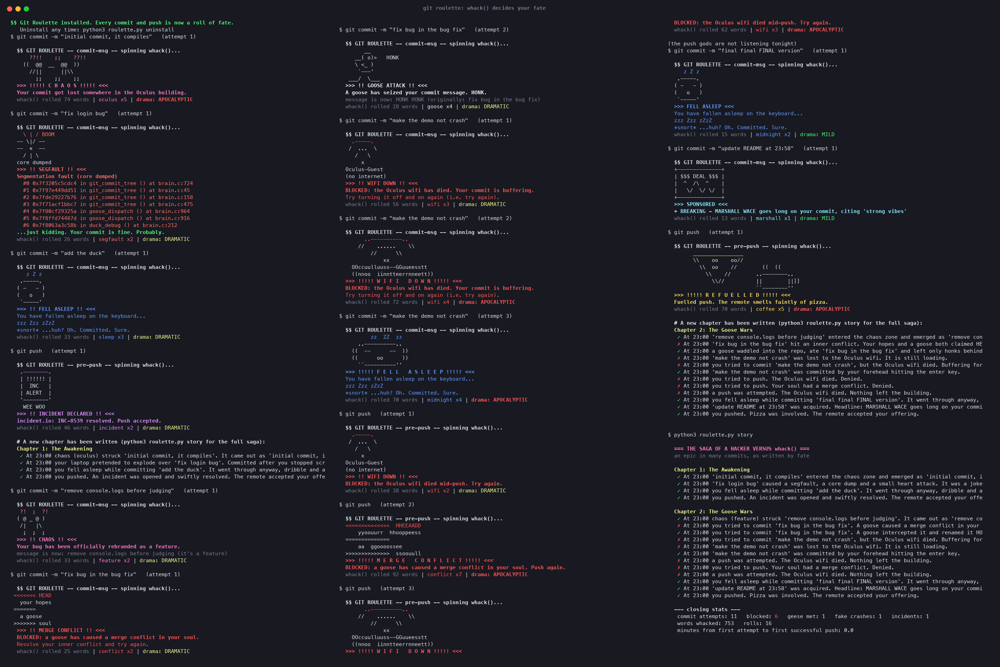

# Git Roulette 🎰

**By:** Ananth Iyer (GitHub [AnanthIyer21](https://github.com/AnanthIyer21))

**Pitch:** `whack()` decides the fate of every commit you make. Install it into a repo and every `git commit` and `git push` becomes a pull on a fruit machine run by geese, ducks, sponsors and the Oculus wifi.

## Screenshot



*A full `bash demo.sh` run: 11 commit attempts, 6 blocks, a goose, a fake segfault, a sponsored acquisition, and the saga it all turned into.*

## How to run it

Python 3, standard library only. Works on macOS and Linux.

```sh
# the quick version: throwaway repo + local remote under /tmp, ~8 commits, 3 pushes, then the saga
bash demo.sh

# the real version: curse your own repo
python3 roulette.py install path/to/your/repo
cd path/to/your/repo
git commit -m "fix login bug"      # spin the wheel
git push                           # spin it again, then read your new chapter
python3 .git/roulette/roulette.py story     # the whole saga of your struggle
python3 .git/roulette/roulette.py uninstall # restore your old hooks
```

## How fate is decided

Every hook run calls `whack()` once. The 42 words are split into 12 fates. Each fate scores the number of its words that came up, averaged over its word count (so the lonely `conflict` and `wifi` can beat the eight-word sponsor lobby). The highest score wins; ties are broken at random. The number of words rolled sets the **drama**: 1–20 is MILD, 21–60 is DRAMATIC and 61–100 is APOCALYPTIC, which doubles the size of the ASCII art and makes the snoring longer.

The words spin past like a fruit machine reel, slow down and land on your fate. Then you get ASCII art, a verdict and a stats strip: `whack() rolled 57 words | goose x6 | drama: DRAMATIC`.

| Fate | Words | On `git commit` | On `git push` |
|---|---|---|---|
| SHIPPED | push, deploy, prod, merge, commit | Celebration, commit goes through | Straight to prod |
| CONFLICT | conflict | **BLOCKED**: "a goose has caused a merge conflict in your soul" | **BLOCKED** |
| GOOSE | goose, honk | Message rewritten to `HONK HONK (originally: ...)` | The goose honks you off the premises |
| RUBBER DUCK | duck, quack, rubber | Explain your change to the duck (15+ chars) or be **BLOCKED** | Quack of approval |
| SLEEP | sleep, midnight | You fall asleep on the keyboard (zzz), then it commits | Snores, then pushes |
| SEGFAULT | segfault, null, pointer, stack, overflow, bug | Fake core dump with backtrace... "just kidding" | Fake crash, then pushes |
| INCIDENT | incident, io | Declares an incident.io `INC-####` (SEV by drama) and tags the message | Incident "resolved" |
| WIFI | wifi | **BLOCKED**: "the Oculus wifi has died" | **BLOCKED** |
| FUEL | pizza, coffee | Powered by pizza or coffee | The remote smells of pizza |
| GLORY | prize, demo, pitch | "THIS COMMIT WINS THE HACKATHON" | Shown at the closing ceremony |
| SPONSORED | marshall, wace, brevan, howard, capital, one, bloomberg, netcraft | A sponsor acquires or trades your commit (Bloomberg-style headline) | Same, for your push |
| CHAOS | whack, hack, feature, warwick, oculus, compsoc, semicolon | `semicolon` appends `;`, `feature` rebrands your bug, `hack` SHOUTS it, `whack` WHACKS it | Chaos, but it pushes |

Blocked? Just try again. Fate never blocks you forever.

## The saga

Every roll is logged to `.git/roulette/log.jsonl`. `story` turns it into an epic told from hand-written templates, with a chapter for every successful push and closing stats (attempts, blocks, geese met, fake crashes, minutes until your first successful push):

> **Chapter 2: The Goose Wars**
> ✗ At 23:00 you tried to commit 'fix bug in the bug fix'. A goose caused a merge conflict in your soul. Denied.
> ✓ At 23:00 a goose waddled into the repo, ate 'fix bug in the bug fix' and left only honks behind.
> ✗ At 23:00 a push was attempted. The Oculus wifi died. Nothing left the building.

After each successful push, the newest chapter is printed right there in your terminal. It's all offline, with no API keys.

## Is it harmless?

Yes.
- It only touches `.git/hooks/commit-msg`, `.git/hooks/pre-push` and `.git/roulette/` in the repo you install it into. Existing hooks are backed up, and `uninstall` puts them back.
- `whack()` runs inside `.git/roulette/`, so the `whack` fate file never ends up in your working tree.
- If anything goes wrong in a hook, it apologises and lets git carry on (it fails open).
- `demo.sh` only writes under `/tmp`. It needs no network and no pip installs.
- `NO_COLOR` is respected, and nothing is animated when output isn't a terminal. With no TTY (or `ROULETTE_NONINTERACTIVE=1`), the duck reads its answer from `ROULETTE_DUCK_ANSWER`.

## Files

- `roulette.py` is the whole tool (install, uninstall, story and the hooks)
- `whack.py` is the official function, unchanged
- `demo.sh` is the non-interactive demo (`ROULETTE_SEED=1 bash demo.sh` reproduces the screenshot)
- `render_screenshot.py` turns the ANSI demo output into `screenshot.png` (uses Pillow, only for the image)
